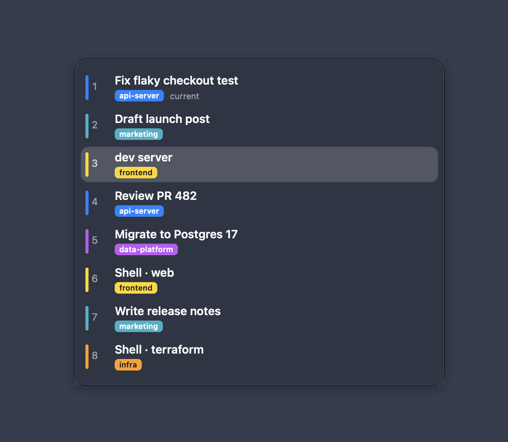
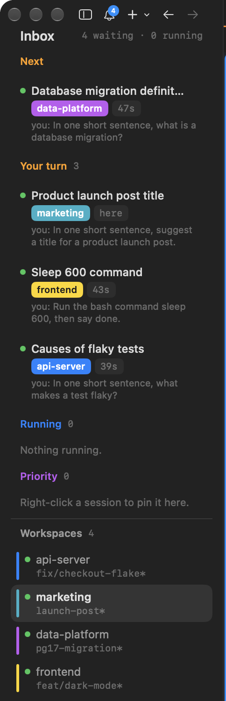

# cmux-setup

Add-ons for [cmux](https://github.com/manaflow-ai/cmux) when you run several coding agents at once: a Cmd+G recent-tab switcher, an Inbox sidebar that shows which agent is waiting on you, and notifications that say which workspace wants what.

This is an unofficial community project. It is not made by or affiliated with the cmux team. It is tested on cmux 0.65.2 with Claude Code on macOS.

|  Cmd+G switcher | Inbox sidebar |
| --- | --- |
|  |  |

The screenshots use invented workspace names. The switcher's `--demo` mode draws the first one without reading your tabs.

## What you get

| Piece | What it does | Docs |
| --- | --- | --- |
| [`switcher/`](switcher/) | Hold Cmd and tap G to see your last eight tabs (not workspaces), Arc and Dia style. Keep tapping G to move down the list, release Cmd to switch. Each row shows the workspace colour. | [docs/switcher.md](docs/switcher.md) |
| [`sidebars/inbox.js`](sidebars/inbox.js) | A left sidebar that puts the agent session you should visit first at the top ("Next"), then the rest of "Your turn", what is running, long-parked sessions, and pinned tabs. Below that, your workspaces with their colours, branch and PR. | [docs/sidebar.md](docs/sidebar.md) |
| [`hooks/enrich-notification.py`](hooks/enrich-notification.py) | Rewrites banners from "Claude Code — Claude is waiting for your input" to "api-server — turn complete", keeps the agent's detail, strips markdown, and restores the detail when cmux's idle reminder would overwrite it. | [docs/notifications.md](docs/notifications.md) |
| [`examples/cmux.json`](examples/cmux.json) | A small config with the settings that help when you run many agents, each with a comment saying why. | |

You can use each piece on its own.

## Quick start

You need cmux, macOS, Python 3 (for the hook), and Xcode's command-line tools (`xcode-select --install`, for the switcher).

```sh
git clone https://github.com/jonobri/cmux-setup.git
cd cmux-setup

# Sidebar: copy it in, check it, switch to it
cp sidebars/inbox.js ~/.config/cmux/sidebars/inbox.js
cmux sidebar validate && cmux sidebar select inbox

# Notifications: copy the hook, then add the "notifications" block from examples/cmux.json
mkdir -p ~/.config/cmux/hooks
cp hooks/enrich-notification.py ~/.config/cmux/hooks/ && chmod +x ~/.config/cmux/hooks/enrich-notification.py
cmux config doctor && cmux reload-config

# Switcher: build and start it (needs a one-time setup, see docs/switcher.md)
switcher/build.sh --setup-signing   # optional, once: keeps the Accessibility permission across rebuilds
switcher/build.sh --install
```

The switcher needs two things only you can do: set cmux's socket mode to **Password** in Settings → Automation, and switch on **CmuxSwitcher** in System Settings → Privacy & Security → Accessibility. [docs/switcher.md](docs/switcher.md) walks through both.

## For agents

If you are a coding agent installing or changing this, read [AGENTS.md](AGENTS.md) first. It lists the steps, what needs a human, how to verify each piece, and the traps.

## Notes on how it works

cmux does not document most of what these pieces rely on. [docs/cmux-internals.md](docs/cmux-internals.md) records what was observed on 0.65.2: the socket's wire format, the `cmux events` stream, how agent sessions are identified, and the notification hook contract. Expect some of it to change between cmux releases.

## Licence

[MIT](LICENSE). Changes are in [CHANGELOG.md](CHANGELOG.md).
